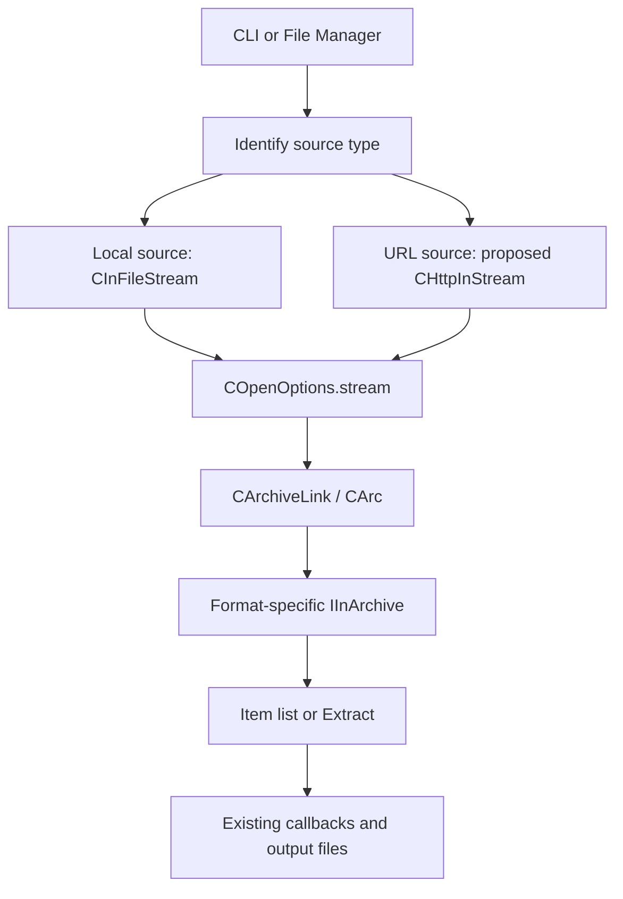

# Source Map and Integration Points

The references below apply to the local version at the time of the study. Line numbers are starting points for reading and may move after edits. Links are relative so they remain useful when the repository is moved.

## 1. Project Layers

| Directory | Role in this study |
|---|---|
| `C` | Low-level compression/decompression algorithms and components, and the project version |
| `Asm` | CPU-architecture optimizations; no changes required to add HTTP |
| `CPP/7zip/Archive` | Archive format readers, indexes, and item extraction |
| `CPP/7zip/Compress` and `Crypto` | Decompression and encryption used by format readers |
| `CPP/7zip/Common` | Streams, reading utilities, limits, and progress |
| `CPP/7zip/UI/Common` | Shared archive opening, extraction, and callbacks |
| `CPP/7zip/UI/Console` | Command-line interface |
| `CPP/7zip/UI/FileManager` and `Agent` | Archive browser and its connection to the reading engine |
| `CPP/7zip/UI/GUI` | Graphical operation interface; this is not the entire File Manager |

## 2. The Contract That Makes This Possible

In [IStream.h](../CPP/7zip/IStream.h), around lines 16, 53, and 87:

- `ISequentialInStream::Read` reads bytes and permits reads shorter than requested.
- If data remains and the read request is nonzero, network delay must not produce success with zero bytes; the reader would interpret that as EOF.
- `IInStream::Seek` supports movement relative to the beginning, current position, or end. Seeking past the source end is allowed; a negative position is an error.
- `IStreamGetSize::GetSize` is an additional size interface.

In [IArchive.h](../CPP/7zip/Archive/IArchive.h), around lines 277–330:

- `IInArchive::Open` accepts `IInStream*`; it does not require a filename on disk.
- `GetNumberOfItems` and `GetProperty` support browsing.
- `Extract` accepts sorted indices and can select individual items or test them without writing files.
- Interfaces on the same `IInArchive` object must not be called concurrently from different threads.

The corresponding local implementation is [CInFileStream](../CPP/7zip/Common/FileStreams.h), around line 41. We replace the byte source while preserving interface contracts and lifetime management through COM-style reference counting. These interfaces do not require the engine to be a Windows COM server.

**The size must be known in the initial random-access mode.** Some paths call `Seek(END)` directly, even if the source implements `IStreamGetSize`. See [StreamUtils.cpp](../CPP/7zip/Common/StreamUtils.cpp), line 18, and `CArc::OpenStream2` around line 1892.

## 3. Shared Opening Path

[OpenArchive.h](../CPP/7zip/UI/Common/OpenArchive.h), line 116, already provides `COpenOptions.stream` alongside `filePath` and `callback`.

In [OpenArchive.cpp](../CPP/7zip/UI/Common/OpenArchive.cpp):

| Reading point | Current behavior | Effect on the addition |
|---|---|---|
| `CArc::OpenStream2`, 1628 | Detects the format and passes the stream to the handler | Reuse the engine; control network format-detection costs |
| `CArc::OpenStreamOrFile`, 3070 | Creates `CInFileStream` only when no stream or stdin is supplied | A network stream injection point already exists |
| `CArchiveLink::Open2`, 3386 | Local callback, or `SetSubArchiveName` when a stream is supplied | Suitable for a single archive; does not automatically support remote volumes |
| `CArchiveLink::ReOpen`, 3483 | Clears `op.stream`, then opens a local file | Needs a source-aware reopening path |
| Subarchive opening, 3321 | Requires a seekable internal stream | Browsing an archive inside another compressed archive does not guarantee random access |

The default archive-start search limit is `1 << 23`, or 8 MiB, at line 45, and a scanning path uses a 1 MiB buffer around line 2125. These are neither a fixed cost for every open nor a global download limit. Format detection must be measured, especially for URLs without extensions, SFX archives, and damaged archives.

## 4. Why Changing One File Is Not Enough

### Command Line

- [ArchiveCommandLine.cpp](../CPP/7zip/UI/Common/ArchiveCommandLine.cpp), around 1550 and 1692: the archive name enters filename, path, and wildcard rules.
- [Main.cpp](../CPP/7zip/UI/Console/Main.cpp), around 1320: `EnumerateDirItemsAndSort` searches for archives locally before opening them.
- [List.cpp](../CPP/7zip/UI/Console/List.cpp), around 1122: listing checks `CFileInfo`; around 1187 it sets `options.stream = NULL`.
- [Extract.cpp](../CPP/7zip/UI/Common/Extract.cpp), around 315 and 372: local size/existence checks occur in two stages; around 427, opening options are created without a stream.

URLs must be detected before wildcard/path normalization, and a source descriptor and metadata must be passed to listing and extraction. A URL must not be converted to a Windows path, and `?` in a signed URL must not be interpreted as a wildcard. Some URL components are case-sensitive; Windows filename comparisons must not be applied to them.

### File Manager

- [PanelFolderChange.cpp](../CPP/7zip/UI/FileManager/PanelFolderChange.cpp), `BindToPath` around 76: general browsing depends on local files and directories.
- [PanelItemOpen.cpp](../CPP/7zip/UI/FileManager/PanelItemOpen.cpp), `OpenAsArc` around 456: accepts `IInStream*` and can serve as a starting point.
- [FileFolderPluginOpen.cpp](../CPP/7zip/UI/FileManager/FileFolderPluginOpen.cpp), 243 and 325: accepts a stream and uses an opening path with progress, but treats the stream as a subarchive when setting up the callback.
- [ArchiveFolderOpen.cpp](../CPP/7zip/UI/Agent/ArchiveFolderOpen.cpp), `OpenFolderFile`: passes the stream to `CAgent::Open`.
- [Agent.cpp](../CPP/7zip/UI/Agent/Agent.cpp), 1628: the local file check is conditional on the absence of `inStream`, which is then passed to `COpenOptions`.

A dedicated “Open URL” button is therefore an easier starting point than integrating URLs into every address-bar rule. The source session must survive browsing and extraction, and refresh/reopen must be updated as well as the opening dialog.

## 5. Multiple Volumes and Source Properties

In [ArchiveOpenCallback.cpp](../CPP/7zip/UI/Common/ArchiveOpenCallback.cpp), `GetStream` around 284 requests the next volume by name, then checks the path, calls `Find_FollowLink`, and opens `CInFileStream`. In subarchive mode it immediately returns `S_FALSE`. `CMultiStreams` management also depends on local files and reopening them. A separate remote volume resolver is required; replacing the first stream is insufficient.

For read-only behavior, [Agent.cpp](../CPP/7zip/UI/Agent/Agent.cpp), `GetFolderProperty(kpidReadOnly)` around 1241, is a UI integration point. Updates must also be blocked in the operation layer; hiding buttons alone is insufficient.

For downloaded-file provenance, [Extract.cpp](../CPP/7zip/UI/Common/Extract.cpp), 457, and [Agent.cpp](../CPP/7zip/UI/Agent/Agent.cpp), 1536, read `Zone.Identifier` from a local file. A network source needs zone metadata passed explicitly according to application policy, reusing [ArchiveExtractCallback.cpp](../CPP/7zip/UI/Common/ArchiveExtractCallback.cpp), around 2078, to write it when appropriate. Do not attempt to read ADS from a URL string.

## 6. Building

Local instructions are in [DOC/readme.txt](../DOC/readme.txt). There are multiple makefiles; adding a dependency to one Visual Studio project is insufficient:

- `UI/Console/makefile` and `Console.mak`.
- `UI/FileManager/makefile`.
- `UI/GUI/makefile` if `7zG` is in scope.
- `Bundles/Alone` and `Bundles/Alone2` if 7za/7zz support is chosen.
- Shared build rules and GCC variants when expanding platform support.

I recommend an optional build flag such as `Z7_HTTP`, a proposed name that does not currently exist, and linking the network backend only into the targeted programs. The archive reader and DLL ABI can remain unchanged.
