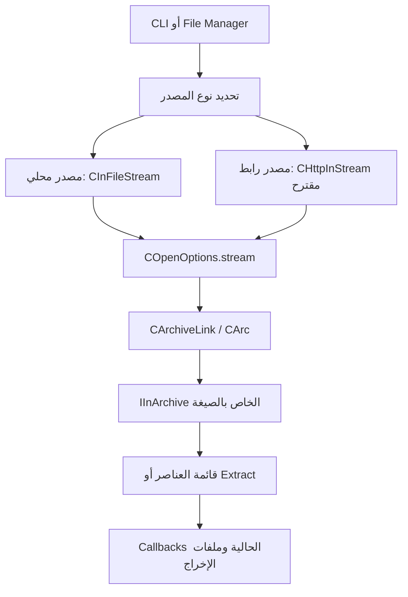

# خريطة المصدر ونقاط الدمج

المراجع التالية تخص النسخة المحلية وقت الدراسة. أرقام الأسطر نقاط بداية للقراءة وقد تتحرك بعد التعديل. الروابط نسبية لتبقى نافعة عند نقل المستودع.

## 1. طبقات المشروع

| المجلد | دوره في هذه الدراسة |
|---|---|
| `C` | خوارزميات ومكونات ضغط وفك ضغط منخفضة المستوى، وإصدار المشروع |
| `Asm` | تطبيقات محسنة لمعمارية المعالج؛ لا يلزم تغييرها لإضافة HTTP |
| `CPP/7zip/Archive` | قارئات صيغ الأرشيف وفهارسها واستخراج العناصر |
| `CPP/7zip/Compress` و`Crypto` | فك الضغط والتشفير المستخدمان بواسطة قارئات الصيغ |
| `CPP/7zip/Common` | streams وأدوات القراءة والحدود والتقدم |
| `CPP/7zip/UI/Common` | منطق فتح الأرشيفات والاستخراج وcallbacks المشتركة |
| `CPP/7zip/UI/Console` | واجهة سطر الأوامر |
| `CPP/7zip/UI/FileManager` و`Agent` | متصفح الأرشيفات وربطه بمحرك القراءة |
| `CPP/7zip/UI/GUI` | واجهة العمليات الرسومية؛ ليست هي File Manager بالكامل |

## 2. العقد الذي يجعل الإضافة ممكنة

في [IStream.h](../CPP/7zip/IStream.h)، الأسطر 16 و53 و87 تقريبًا:

- `ISequentialInStream::Read` يقرأ بايتات، ويسمح بقراءة أقصر من المطلوبة.
- إذا كان هناك بيانات وطلب القراءة غير صفري، لا يصح إرجاع نجاح وصفر بايت بسبب تأخر الشبكة؛ هذا يشبه EOF للقارئ.
- `IInStream::Seek` يتيح الانتقال باستخدام البداية أو الموضع الحالي أو النهاية. يسمح بتجاوز نهاية المصدر؛ الموضع السالب خطأ.
- `IStreamGetSize::GetSize` واجهة إضافية للحجم.

في [IArchive.h](../CPP/7zip/Archive/IArchive.h)، قرب الأسطر 277–330:

- `IInArchive::Open` يستقبل `IInStream*`؛ لا يشترط اسم ملف على القرص.
- `GetNumberOfItems` و`GetProperty` يتيحان التصفح.
- `Extract` يستقبل indices مرتبة، ويمكن اختيار عناصر بعينها أو اختبارها دون كتابة ملفات.
- لا يجوز استدعاء واجهات كائن `IInArchive` نفسه بالتوازي من threads مختلفة.

التطبيق المحلي المقابل هو [CInFileStream](../CPP/7zip/Common/FileStreams.h)، قرب السطر 41. نستبدل مصدر البايتات، مع الحفاظ على عقود الواجهات وإدارة العمر عبر COM-style reference counting. هذه الواجهات لا تفرض أن المحرك Windows COM server.

**الحجم يجب أن يكون معروفًا في وضع random access الأول.** بعض المسارات تستخدم `Seek(END)` مباشرة، حتى لو طبّق المصدر `IStreamGetSize`. راجع [StreamUtils.cpp](../CPP/7zip/Common/StreamUtils.cpp)، السطر 18، و`CArc::OpenStream2` قرب السطر 1892.

## 3. مسار الفتح المشترك

في [OpenArchive.h](../CPP/7zip/UI/Common/OpenArchive.h)، السطر 116، يوجد أصلًا `COpenOptions.stream` بجانب `filePath` و`callback`.

في [OpenArchive.cpp](../CPP/7zip/UI/Common/OpenArchive.cpp):

| نقطة القراءة | الموجود الآن | أثره على الإضافة |
|---|---|---|
| `CArc::OpenStream2`، 1628 | اكتشاف الصيغة وتمرير stream إلى handler | إعادة استخدام المحرك؛ ضبط تكاليف اكتشاف النوع على الشبكة |
| `CArc::OpenStreamOrFile`، 3070 | ينشئ `CInFileStream` فقط عند غياب stream وstdin | نقطة تمرير المصدر الشبكي موجودة بالفعل |
| `CArchiveLink::Open2`، 3386 | callback محلي أو `SetSubArchiveName` عند وجود stream | جيد للأرشيف المفرد؛ لا يحقق remote volumes تلقائيًا |
| `CArchiveLink::ReOpen`، 3483 | يصفر `op.stream` ثم يفتح ملفًا محليًا | يحتاج مسار إعادة فتح يعتمد على نوع المصدر |
| فتح subarchive، 3321 | يتطلب stream داخليًا قابلًا لـSeek | التصفح داخل أرشيف مضغوط آخر لا يضمن random access |

هناك حد افتراضي للبحث عن بداية الأرشيف `1 << 23`، أي 8 MiB، في السطر 45، ومسار فحص يستخدم buffer بحجم 1 MiB قرب 2125. هذه ليست تكلفة ثابتة لكل فتح، وليست حدًا شاملًا لكل تنزيل. يجب قياس اكتشاف النوع، خصوصًا الروابط دون امتداد وSFX والأرشيفات التالفة.

## 4. لماذا تغيير ملف واحد غير كافٍ؟

### سطر الأوامر

- [ArchiveCommandLine.cpp](../CPP/7zip/UI/Common/ArchiveCommandLine.cpp)، قرب 1550 و1692: اسم الأرشيف يدخل في قواعد أسماء ومسارات وwildcards.
- [Main.cpp](../CPP/7zip/UI/Console/Main.cpp)، قرب 1320: `EnumerateDirItemsAndSort` يبحث عن الأرشيفات محليًا قبل فتحها.
- [List.cpp](../CPP/7zip/UI/Console/List.cpp)، قرب 1122: listing يفحص `CFileInfo`؛ وقرب 1187 يضبط `options.stream = NULL`.
- [Extract.cpp](../CPP/7zip/UI/Common/Extract.cpp)، قرب 315 و372: فحص محلي للحجم والوجود في مرحلتين؛ وقرب 427 ينشئ خيارات فتح دون stream.

المطلوب اكتشاف الرابط قبل wildcard/path normalization، وتمرير source descriptor وmetadata إلى listing وextract. لا نعالج الرابط بتحويله إلى مسار Windows، ولا نفسر `?` في signed URL كـwildcard. عناوين URL حساسة لحالة بعض أجزائها؛ لا نطبق عليها مقارنة أسماء ملفات Windows.

### File Manager

- [PanelFolderChange.cpp](../CPP/7zip/UI/FileManager/PanelFolderChange.cpp)، `BindToPath` قرب 76: مسار التصفح العام يعتمد على ملفات ومجلدات محلية.
- [PanelItemOpen.cpp](../CPP/7zip/UI/FileManager/PanelItemOpen.cpp)، `OpenAsArc` قرب 456: يستقبل `IInStream*`، ويمكن البناء عليه.
- [FileFolderPluginOpen.cpp](../CPP/7zip/UI/FileManager/FileFolderPluginOpen.cpp)، 243 و325: يستقبل stream ويعمل داخل مسار فتح له progress؛ لكنه يعامل stream كـsubarchive عند إعداد callback.
- [ArchiveFolderOpen.cpp](../CPP/7zip/UI/Agent/ArchiveFolderOpen.cpp)، `OpenFolderFile`: يمرر stream إلى `CAgent::Open`.
- [Agent.cpp](../CPP/7zip/UI/Agent/Agent.cpp)، 1628: فحص الملف المحلي مشروط بغياب `inStream`، ثم يمرره إلى `COpenOptions`.

لذلك زر مستقل «فتح رابط» أسهل بداية من إدخال الرابط في كل قواعد شريط العنوان. يجب الاحتفاظ بجلسة المصدر طوال التصفح والاستخراج، وتعديل refresh/reopen، وليس نافذة الفتح وحدها.

## 5. أجزاء متعددة وخصائص المصدر

في [ArchiveOpenCallback.cpp](../CPP/7zip/UI/Common/ArchiveOpenCallback.cpp)، `GetStream` قرب 284، يتم طلب الجزء التالي بالاسم، ثم تطبيق فحص المسار و`Find_FollowLink` وفتح `CInFileStream`. وفي وضع subarchive يرجع `S_FALSE` مباشرة. كذلك إدارة `CMultiStreams` مرتبطة بملفات محلية وإعادة فتحها. يلزم remote volume resolver مستقل، ولا يكفي استبدال أول stream.

للقراءة فقط: [Agent.cpp](../CPP/7zip/UI/Agent/Agent.cpp)، `GetFolderProperty(kpidReadOnly)` قرب 1241، نقطة ربط بالواجهة. لكن منع التحديث يجب تطبيقه أيضًا في طبقة العمليات، لأن مجرد إخفاء الأزرار لا يكفي.

لأصل الملفات المحملة: [Extract.cpp](../CPP/7zip/UI/Common/Extract.cpp)، 457، و[Agent.cpp](../CPP/7zip/UI/Agent/Agent.cpp)، 1536، يقرآن `Zone.Identifier` من ملف محلي. المصدر الشبكي يحتاج تمرير zone metadata صراحة وفق سياسة البرنامج، وإعادة استخدام [ArchiveExtractCallback.cpp](../CPP/7zip/UI/Common/ArchiveExtractCallback.cpp)، قرب 2078، لكتابتها عند الاقتضاء. لا نحاول قراءة ADS من نص URL.

## 6. البناء

التعليمات المحلية في [DOC/readme.txt](../DOC/readme.txt). توجد makefiles متعددة، وليست إضافة dependency إلى مشروع Visual Studio واحد كافية:

- `UI/Console/makefile` و`Console.mak`.
- `UI/FileManager/makefile`.
- `UI/GUI/makefile` إذا شمل النطاق `7zG`.
- `Bundles/Alone` و`Bundles/Alone2` إذا تقرر دعم 7za/7zz.
- قواعد البناء المشتركة ونسخ GCC عند توسيع دعم المنصات.

أوصي بعلم بناء اختياري مثل `Z7_HTTP`، اسم مقترح غير موجود حاليًا، وربط backend الشبكة في البرامج المستهدفة فقط. يمكن إبقاء ABI الخاص بقارئات الأرشيف وDLL دون تغيير.
