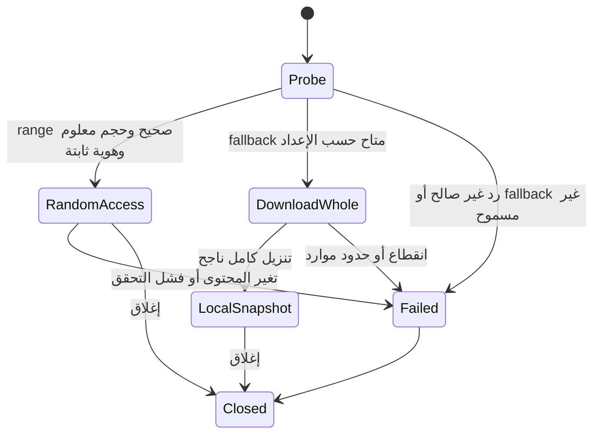

# تصميم مقترح لمصدر HTTP

كل أسماء الكلاسات والإعدادات الجديدة أدناه اقتراحات، وليست كودًا موجودًا. الهدف عزل الشبكة عن قارئات الأرشيف والحفاظ على سلوك الملفات المحلية.

## 1. المكونات

| المكون المقترح | المسؤولية |
|---|---|
| `CArchiveSource` | نوع المصدر، metadata، الاسم المعروض، صلاحية القراءة فقط، وإنشاء/إعادة فتح الجلسة |
| `CHttpInStream` | `Read` و`Seek` و`GetSize` ومؤشر قراءة 64-bit |
| `IHttpTransport` | طلبات HTTP، headers، redirects، timeouts، cancel؛ ليس parser للأرشيف |
| `CWinHttpTransport` | تنفيذ Windows |
| `CRangeCache` | حفظ البايتات التي تم التحقق منها، مع حدود ذاكرة/قرص |
| `CRemoteOpenCallback` | metadata وكلمة المرور، ثم resolver للأجزاء في مرحلة لاحقة |
| `CRemoteSession` | حجم ثابت، هوية المحتوى، إحصاءات، lifetime، وسياسة التنزيل الكامل |

نفصل `RequestUrl` عن `DisplayName` وعن أي `LocalTempPath`. امتداد الاسم المستخرج من URL أو Content-Disposition مجرد hint؛ نتحقق من التوقيع بالمحرك. لا نستعمل اسم السيرفر كمسار إخراج موثوق. لا نزيل query parameters أو نعيد ترتيبها في الطلبات الموقعة.

## 2. أساس HTTP الذي يعتمد عليه التصميم

يمكن طلب نطاق بايتات بـ`Range`. السيرفر قد يتجاهله؛ لذلك `Accept-Ranges` ليس دليلًا كافيًا. الرد الجزئي `206` يصف موضعه عبر `Content-Range`. `If-Match` يستخدم مقارنة ETag قوية، بينما `If-Range` قد يؤدي إلى رد كامل عند تغير المحتوى. لا يساوي Content-Length في الرد الجزئي حجم الأرشيف الكامل. هذه قواعد البروتوكول التي يبنى عليها التحقق. [RFC 9110: Range وContent-Range](https://www.rfc-editor.org/rfc/rfc9110.html#section-14)، [الشروط](https://www.rfc-editor.org/rfc/rfc9110.html#section-13.1).

بقية هذا الملف سياسة تنفيذ مقترحة للمشروع، وليست ادعاء بأن المعيار يفرض كل هذه الخيارات.

## 3. فتح الجلسة

1. قبول HTTP/HTTPS فقط، مع HTTPS كاختيار مفضل. لا دعم لصفحات تسجيل الدخول أو تشغيل JavaScript أو حل روابط خدمات التخزين تلقائيًا.
2. إجراء GET صغير، مثل `Range: bytes=0-0`، مع `Accept-Encoding: identity`. HEAD يمكن استخدامه كمعلومة مساعدة، لكن فشله لا يمنع اختبار GET.
3. قراءة status والheaders قبل استهلاك body كبير. إن جاء `206` نتحقق من الموضع، والطول، والحجم الإجمالي، ونحتفظ بالبايت داخل cache.
4. تثبيت الحجم وstrong ETag ووجهة الطلب وسياق المصادقة للجلسة. كل طلب لاحق يحمل `If-Match` بنفس ETag.
5. طلب تمثيل غير محول تلقائيًا؛ لا نسمح لـHTTP backend بفك content coding وتغيير offsets من وراء stream. رفض تمثيل غير متوافق في وضع ranges؛ تنزيل snapshot متسق بديل مستقل إن سمحت السياسة.
6. عدم معرفة الحجم أو غياب strong validator في MVP يعني full-download mode أو خطأ واضح. `Last-Modified + size` ليس بديلًا مكافئًا لإثبات نفس البايتات.

قرار strong ETag محافظ وقد يقلل عدد الروابط المناسبة للتنزيل الجزئي. يمكن لاحقًا دراسة رابط object-version ثابت كبديل صريح. ETag ليس checksum تشفيريًا ولا إثبات أن محتوى الأرشيف آمن.

## 4. آلة الحالات

إذا بدأ المحرك الفتح ثم اكتشفنا تغير المصدر، لا نواصل تركيب bytes جديدة على cache القديمة. نغلق العملية؛ إعادة المحاولة تبدأ جلسة ومحركًا جديدين. التحول لتنزيل كامل أثناء جلسة مفتوحة يحتاج إعادة فتح parser على snapshot جديد، وليس تبديل بايتات تحت كائن قائم.

## 5. عقد `Read` و`Seek`

`Seek` يحسب الموضع فقط دون تنزيل الفجوة. يحمي الحساب من overflow، ويرفض origin غير صالح أو موضعًا سالبًا؛ يسمح بالموضع بعد EOF كما ينص `IStream.h`. نرفض أحجامًا غير قابلة للتمثيل الآمن في عمليات Seek الحالية بدل truncation.

`Read` يبدأ بتصفير `processedSize`. طلب صفر بايت ينجح. الموضع عند/بعد نهاية المصدر يرجع EOF محليًا دون HTTP. غير ذلك، يخدم cache أو يجلب block ناقصًا، يتحقق منه ثم ينسخ البيانات ويحرك المؤشر. فشل الشبكة قبل EOF خطأ، وليس نجاحًا بصفر بايت. القراءة القصيرة مسموحة وفق عقد الواجهة، لكن لا نجعل body ناقصًا صالحًا بصمت.

`GetSize` يعيد حجم الجلسة المثبت دون طلب جديد. لا ننفذ `IStreamGetProps2` بهوية ملف وهمية. أي metadata غير معروفة تبقى غير معروفة، ويمكن دعم `IStreamGetProps` عند وجود داعٍ مثبت.

## 6. cache والأداء

- بداية تجريبية قابلة للضبط: blocks مقدارها 256 KiB، وذاكرة 32 MiB، وطلب شبكي واحد في كل مرة. ليست أرقامًا نهائية أو قياسات.
- دمج القراءة المتجاورة، وإعادة استخدام الاتصال، ثم read-ahead محدود عند إثبات نمط متسلسل.
- حفظ ranges المعتمدة فقط؛ block غير مكتمل أو مختلف الهوية لا يدخل cache.
- cache على القرص اختياري بحد مساحة واضح، وملفات خاصة بالمستخدم وتنظيف عند الإغلاق/الفشل.
- لو استُخدم sparse file، holes ليست بيانات صالحة؛ يلزم bitmap/interval map يحدد الأجزاء المحملة. لا نسلم الملف المتقطع مباشرة لقارئ يتوقع كل بايتاته موجودة.
- عزل cache بين الجلسات في البداية. إعادة الاستخدام بين الجلسات تحتاج ربطًا بهوية المحتوى وسياق الدخول والتمثيل، وليس URL أو اسم الملف وحده.
- إضافة قيود مستقلة على عدد الطلبات والبايتات في مرحلة probing؛ بلوغها ينتج تشخيصًا واضحًا أو fallback، لا «أرشيف تالف» مضللًا.

block كبير يحسن latency لكنه قد ينزل بيانات غير مطلوبة بكثرة مع TAR/RAR. تُضبط السياسة بعد قياس القراءة الفعلية لكل صيغة.

## 7. ردود وأخطاء يجب تمييزها

| الحالة | سياسة العميل المقترحة |
|---|---|
| `206` صالح | التحقق من بداية/نهاية النطاق والحجم والهوية قبل اعتماد البيانات |
| `200` بعد Range | لا نضع body عند offset المطلوب؛ fallback مستقل أو فشل |
| `412` أو اختلاف ETag/الحجم | إبطال الجلسة؛ المصدر تغير |
| `416` أثناء قراءة يفترض أنها قبل EOF | فشل اتساق؛ إعادة probe في جلسة جديدة، لا إخفاؤه كـEOF |
| مصدر صفر الحجم | تمييزه عن تعطل الشبكة ثم إبلاغ المحرك؛ ليس أرشيفًا صالحًا بالضرورة |
| `401/403` | مصادقة مطلوبة أو رابط منتهي؛ لا retries عمياء |
| `404` | المصدر/الجزء غير موجود |
| `429` أو خطأ عابر/انقطاع | retries محدودة مع backoff قابل للإلغاء، وبنفس validator |
| HTML بدل archive | رفض واضح عند ثبوت صفحة خطأ؛ Content-Type وحده لا يحسم صلاحية الأرشيف |
| TLS/Content-Range غير صالح أو body مبتور | خطأ نقل/بروتوكول، لا CRC error عام |

في MVP نطلب نطاقًا واحدًا متصلًا؛ الرد multipart غير المتوقع يرفض بدل إدخال MIME bytes للمحرك. تبقى أخطاء كلمة المرور وCRC الخاصة بالأرشيف منفصلة عن أخطاء النقل.

## 8. اختيار مكتبة النقل

WinHTTP متاح لبرامج C/C++، ولا يشارك browser cookies أو cache أو credentials تلقائيًا. هذا يناسب رابطًا مباشرًا وسلوكًا واضحًا بين CLI وGUI، لكنه لا يجعل روابط جلسة المتصفح تعمل تلقائيًا. هذا **ترجيح هندسي**؛ ليس توصية عامة بأن كل تطبيق desktop يجب أن يستخدم WinHTTP. [وثائق Microsoft](https://learn.microsoft.com/en-us/windows/win32/winhttp/about-winhttp).

نحتاج قراءة headers والتحقق منها وتحديد timeouts صريحة؛ راجع [WinHttpQueryHeaders](https://learn.microsoft.com/en-us/windows/win32/api/winhttp/nf-winhttp-winhttpqueryheaders) و[WinHttpSetTimeouts](https://learn.microsoft.com/en-us/windows/win32/api/winhttp/nf-winhttp-winhttpsettimeouts). تُقرأ قيم الأحجام كنص وتُحلل 64-bit مع فحص overflow، لا بافتراض DWORD يكفي.

libcurl بديل مناسب لتوحيد المنصات، ويتيح `CURLOPT_RANGE`، لكن استدعاء الخيار وحده لا يضمن ردًا جزئيًا؛ التطبيق يظل مسؤولًا عن التحقق. كلفته dependency وبناء وتوزيع إضافيان. [وثائق libcurl](https://curl.se/libcurl/c/CURLOPT_RANGE.html).

## 9. عمر الجلسة وتجربة الاستخدام

- النقل يعمل خارج UI thread؛ callbacks الحالية تستقبل التقدم والإلغاء. `IInStream::Read` متزامن، لذلك يجب ألا يتجمد UI أثناءه.
- وجود timeout لا يكفي وحده لإلغاء سريع. نحدد آلية cancel آمنة مع request lifetime ونختبرها؛ لا نغلق handles عشوائيًا من threads مختلفة.
- عمليات handler الواحد متتابعة. prefetch إن أضيف يعمل على offsets مستقلة ولا يغير مؤشر stream الذي يراه المحرك.
- progress يعرض تنزيل الشبكة منفصلًا عن فك الضغط. حجم المصدر ليس بالضرورة حجم التنزيل اللازم؛ لا نظهر نسبة شبكة مزيفة حين يكون المطلوب غير معلوم.
- قبل fallback الكامل يظهر الحجم إن عُرف والسبب. CLI يحتاج اختيار سياسة صريحًا يناسب التشغيل غير التفاعلي؛ هذه سياسة منتج مقترحة وليست طلب موافقة أثناء الدراسة.
- الروابط السرية لا تدخل logs/history نصيًا دون سياسة واضحة. نحجب query وuserinfo في التشخيصات؛ نحفظ النص الأصلي للطلب في الجلسة فقط.
- نتحقق من TLS، ونحدد عدد redirects، ونمنع downgrade الصامت من HTTPS. عند تغير origin لا ننقل Authorization أو cookies تلقائيًا. دعم proxy/auth الصريح يمكن إضافته لاحقًا.
- نسمح بتحميل من خادم يحدده المستخدم، بما فيه خادم محلي إن أراد؛ لكن أسماء volumes داخل الأرشيف لا تمنح إذنًا تلقائيًا لطلب hosts أو مسارات عشوائية.
- remote read-only يمتد إلى عمليات التعديل والحذف وفتح ملف خارجي ثم حفظه داخل الأرشيف. يمكن لاحقًا «حفظ نسخة محلية»، لكن لا رفع تلقائي.
- تستمر معالجة مسارات الاستخراج والروابط وسياسة Zone.Identifier عبر آليات البرنامج الحالية، مع metadata صحيحة للمصدر الشبكي.
