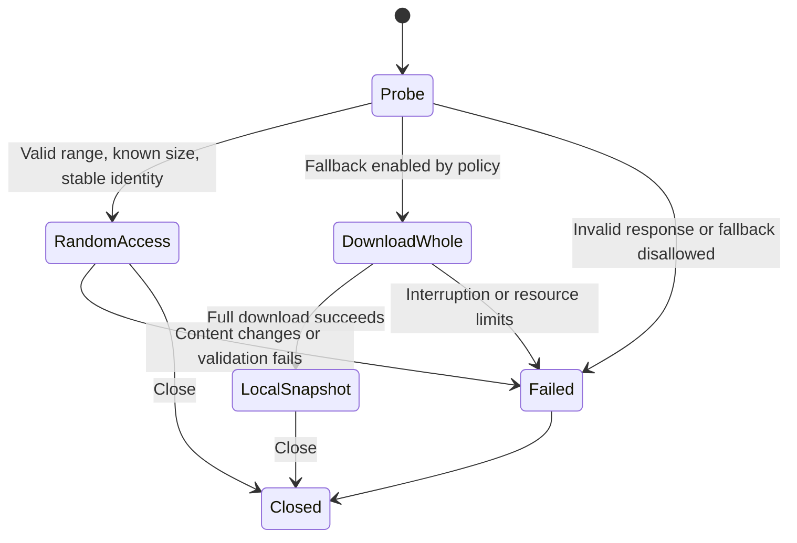

# Proposed HTTP Source Design

This is the broader design from the initial study. For the current prototype implementation and its intentional differences, see [Initial implementation results](06-prototype-results.md).

All new class and setting names below are proposals, not existing code. The goal is to isolate networking from archive readers and preserve local-file behavior.

## 1. Components

| Proposed component | Responsibility |
|---|---|
| `CArchiveSource` | Source type, metadata, display name, read-only status, and session creation/reopening |
| `CHttpInStream` | `Read`, `Seek`, `GetSize`, and a 64-bit read position |
| `IHttpTransport` | HTTP requests, headers, redirects, timeouts, and cancellation; not an archive parser |
| `CWinHttpTransport` | Windows implementation |
| `CRangeCache` | Store validated bytes within memory/disk limits |
| `CRemoteOpenCallback` | Metadata and passwords, followed by a volume resolver in a later phase |
| `CRemoteSession` | Fixed size, content identity, statistics, lifetime, and full-download policy |

Keep `RequestUrl`, `DisplayName`, and any `LocalTempPath` separate. An extension obtained from a URL or Content-Disposition is only a hint; verify the signature through the engine. Do not trust a server-supplied name as an output path. Do not remove or reorder query parameters in signed requests.

## 2. HTTP Foundations

A byte range can be requested using `Range`. The server may ignore it, so `Accept-Ranges` is insufficient evidence. A partial `206` response describes its position through `Content-Range`. `If-Match` uses strong ETag comparison, whereas `If-Range` may produce a full response when content changes. Content-Length in a partial response is not the full archive size. These protocol rules underpin validation. [RFC 9110: Range and Content-Range](https://www.rfc-editor.org/rfc/rfc9110.html#section-14), [Conditions](https://www.rfc-editor.org/rfc/rfc9110.html#section-13.1).

The rest of this file proposes an implementation policy for the project; it does not claim that the standard mandates all these choices.

## 3. Opening a Session

1. Accept HTTP/HTTPS only, preferring HTTPS. Do not support login pages, execute JavaScript, or automatically resolve storage-service sharing links.
2. Perform a small GET, such as `Range: bytes=0-0`, with `Accept-Encoding: identity`. HEAD may provide supplementary information, but its failure must not prevent a GET probe.
3. Read status and headers before consuming a large body. For `206`, validate the position, length, and total size, and retain the byte in cache.
4. Pin the size, strong ETag, request destination, and authentication context for the session. Every subsequent request carries `If-Match` with the same ETag.
5. Request a representation without automatic transformation; do not allow the HTTP backend to decode content coding and silently change offsets beneath the stream. Reject incompatible representations in range mode; downloading a consistent snapshot is a separate alternative if policy permits.
6. Unknown size or a missing strong validator in the MVP means full-download mode or a clear error. `Last-Modified + size` is not equivalent evidence of identical bytes.

Requiring a strong ETag is conservative and may reduce the number of links suitable for partial downloading. A fixed object-version URL could later be studied as an explicit alternative. An ETag is neither a cryptographic checksum nor proof that archive contents are safe.

## 4. State Machine

If the engine has started opening and a source change is detected, do not combine new bytes with the old cache. Abort the operation; a retry starts a new session and engine instance. Switching to a full download during an open session requires reopening the parser on a new snapshot, not replacing bytes beneath an existing object.

## 5. `Read` and `Seek` Contracts

`Seek` computes the position without downloading the gap. Guard arithmetic against overflow and reject invalid origins or negative positions; positions beyond EOF are allowed by `IStream.h`. Reject sizes that cannot be represented safely in current Seek operations rather than truncating them.

`Read` first sets `processedSize` to zero. A zero-byte request succeeds. At or beyond the source end, return EOF locally without HTTP. Otherwise, serve cached data or fetch a missing block, validate it, copy the data, and advance the position. A network failure before EOF is an error, not success with zero bytes. Short reads are permitted by the interface contract, but a truncated body must not silently become valid data.

`GetSize` returns the pinned session size without a new request. Do not implement `IStreamGetProps2` with a fabricated file identity. Unknown metadata remains unknown; `IStreamGetProps` can be supported when a demonstrated need exists.

## 6. Cache and Performance

- An adjustable experimental starting point: 256 KiB blocks, 32 MiB memory, and one network request at a time. These are neither final values nor measurements.
- Coalesce adjacent reads, reuse connections, then add bounded read-ahead when a sequential pattern is established.
- Cache only validated ranges; incomplete blocks or blocks with a different identity must not enter the cache.
- Optional disk caching needs an explicit space limit, user-private files, and cleanup on close/failure.
- If a sparse file is used, holes are not valid data; a bitmap/interval map must identify downloaded regions. Do not pass the sparse file directly to a reader expecting every byte to exist.
- Initially isolate caches between sessions. Cross-session reuse requires binding to content identity, authentication context, and representation, not just a URL or filename.
- Add separate request-count and byte limits during probing; reaching them should produce a clear diagnostic or fallback, not a misleading “corrupt archive” error.

Large blocks improve latency but may download substantial unnecessary data with TAR/RAR. Tune the policy after measuring actual reads for each format.

## 7. Responses and Errors to Distinguish

| Condition | Proposed client policy |
|---|---|
| Valid `206` | Validate range start/end, size, and identity before accepting data |
| `200` after Range | Do not place the body at the requested offset; use separate fallback or fail |
| `412` or ETag/size mismatch | Invalidate the session; the source changed |
| `416` during a read expected to be before EOF | Consistency failure; probe again in a new session rather than hiding it as EOF |
| Zero-length source | Distinguish it from network failure, then inform the engine; it is not necessarily a valid archive |
| `401/403` | Authentication required or expired link; no blind retries |
| `404` | Source/volume does not exist |
| `429` or transient failure/interruption | Bounded retries with cancellable backoff and the same validator |
| HTML instead of an archive | Clearly reject an identified error page; Content-Type alone does not determine archive validity |
| Invalid TLS/Content-Range or truncated body | Transport/protocol error, not a generic CRC error |

The MVP requests one contiguous range; reject an unexpected multipart response rather than passing MIME bytes to the engine. Archive password and CRC errors remain separate from transport errors.

## 8. Choosing a Transport Library

WinHTTP is available to C/C++ programs and does not automatically share browser cookies, cache, or credentials. This suits direct links and predictable behavior across CLI and GUI, but does not automatically make browser-session links work. This is an **engineering preference**, not a general recommendation that every desktop application should use WinHTTP. [Microsoft documentation](https://learn.microsoft.com/en-us/windows/win32/winhttp/about-winhttp).

Headers must be read and validated, and explicit timeouts configured; see [WinHttpQueryHeaders](https://learn.microsoft.com/en-us/windows/win32/api/winhttp/nf-winhttp-winhttpqueryheaders) and [WinHttpSetTimeouts](https://learn.microsoft.com/en-us/windows/win32/api/winhttp/nf-winhttp-winhttpsettimeouts). Read size values as text and parse them as 64-bit integers with overflow checks; do not assume a DWORD is sufficient.

libcurl is a suitable cross-platform alternative and exposes `CURLOPT_RANGE`, but setting that option alone does not guarantee a partial response; validation remains the application's responsibility. Its cost is an additional dependency and build/distribution work. [libcurl documentation](https://curl.se/libcurl/c/CURLOPT_RANGE.html).

## 9. Session Lifetime and User Experience

- Run transport work outside the UI thread; existing callbacks receive progress and cancellation. `IInStream::Read` is synchronous, so the UI must not freeze during it.
- A timeout alone does not ensure prompt cancellation. Define and test a safe cancellation mechanism that respects request lifetime; do not close handles arbitrarily from different threads.
- Operations on a single handler are sequential. If added, prefetch works on independent offsets and does not change the stream position seen by the engine.
- Show network download progress separately from decompression. Source size is not necessarily the required download size; do not show a fabricated network percentage when the required amount is unknown.
- Before full fallback, show the size if known and the reason. CLI needs an explicit policy suitable for noninteractive use; this is a proposed product policy, not an approval request during the study.
- Secret URLs must not enter logs/history verbatim without a clear policy. Redact query and userinfo in diagnostics; keep the original request text only in the session.
- Validate TLS, limit redirects, and prevent silent HTTPS downgrades. Do not automatically forward Authorization or cookies across origins. Explicit proxy/auth support can be added later.
- Allow downloads from a user-selected server, including a local server if desired; volume names inside an archive do not automatically authorize requests to arbitrary hosts or paths.
- Remote read-only behavior covers update/delete operations and opening an external file then saving it back into the archive. “Save a local copy” can be added later, but no automatic upload.
- Continue handling extraction paths, links, and Zone.Identifier policy through existing application mechanisms, with correct metadata for the network source.
